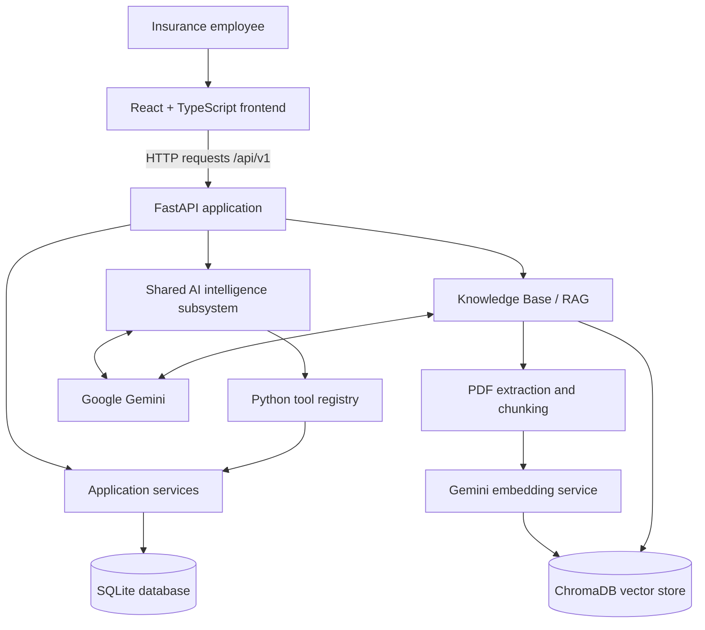
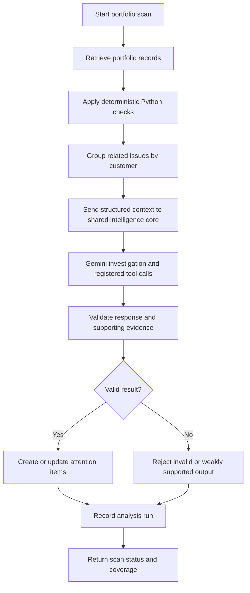
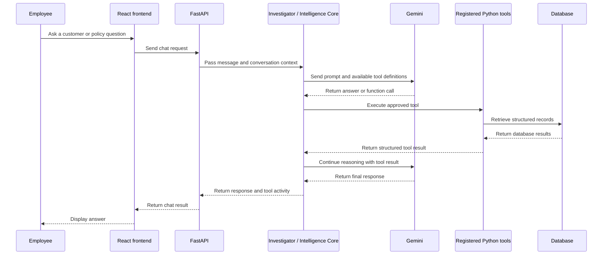
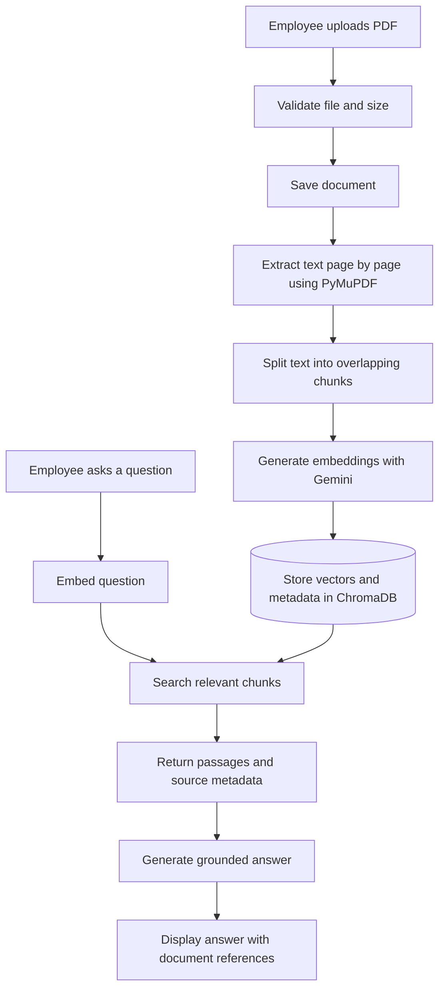
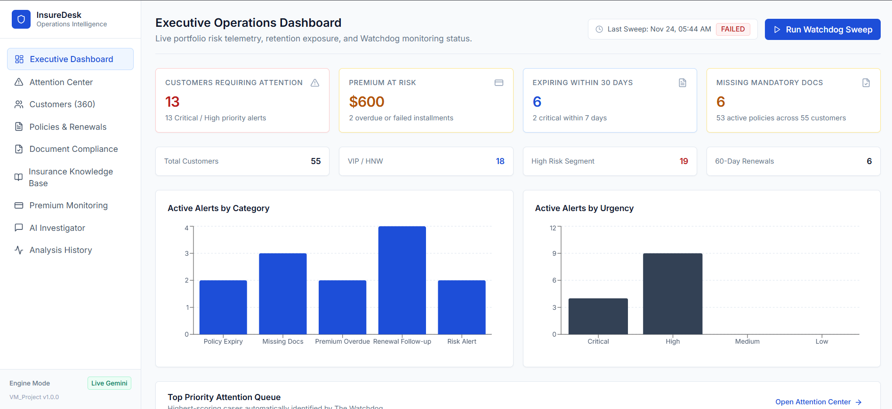
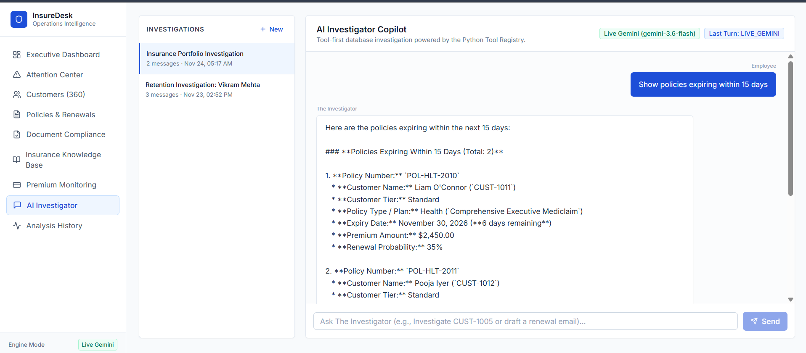
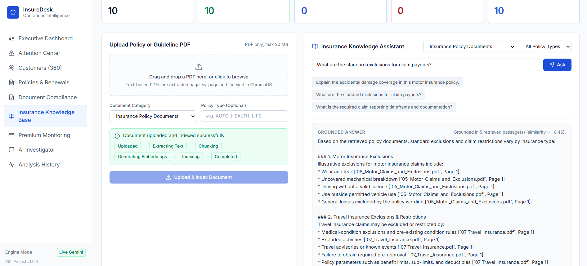

# InsureAI

### Insurance Customer Intelligence Platform

InsureAI is a web application for insurance teams to review
customer portfolios, monitor policy and premium risks, track document
compliance, and investigate customer cases with AI assistance.

The project brings structured insurance records and document-based
knowledge into one application. Its main workflows are:

-   **The Watchdog** -- proactively scans the customer portfolio and
    raises evidence-backed attention items.
-   **The Investigator** -- a conversational AI copilot that uses
    controlled backend tools to investigate customer and policy records.
-   **Insurance Knowledge Base** -- indexes PDF documents and retrieves
    relevant passages for document-grounded answers.
-   **Portfolio workspace** -- provides dashboard metrics and dedicated
    screens for customers, policies, billing, renewals, document
    compliance, and analysis history.

The application is intended for development, demonstration, and
portfolio use. Used fictional or properly anonymized data.

------------------------------------------------------------------------

## Project overview

Insurance operations involve multiple connected records: customers,
policies, premiums, claims, renewals, and mandatory documents. Reviewing
these records manually can make it difficult to identify customers who
need timely follow-up.

InsureAI is designed to bring these records together and help an
insurance employee answer questions such as:

-   Which customers need immediate attention?
-   Which policies are approaching expiry?
-   Are there unpaid or overdue premiums?
-   Which customers have missing or expired documents?
-   Why was a customer assigned a high-priority attention item?
-   What does an uploaded insurance document say about a particular
    condition?

The system separates factual data retrieval and business calculations
from AI-generated interpretation. Python services retrieve records and
apply deterministic checks; the AI layer interprets the supplied context
and produces explanations or recommendations. Customer-specific facts
should be grounded in retrieved application data rather than invented by
the language model.

Key Features
1. Portfolio Dashboard
Displays overall portfolio metrics, including customers, active policies, high-priority cases, premium risks, missing documents, and upcoming expirations.

2. Customer Management
Allows employees to search customers and view their complete profiles, including policies, payments, claims, documents, and follow-up history.

3. Policy Management
Provides policy details, expiry tracking, and renewal monitoring to identify policies requiring attention.

4. Billing & Premium Monitoring
Tracks premium payments and highlights overdue or unpaid amounts for timely follow-up.

5. Document Compliance
Monitors customer documents and identifies missing, rejected, or expired mandatory documents.

6. The Watchdog - Proactive AI Monitoring
Automatically scans customer portfolios to identify policy expirations, payment issues, and document compliance risks. Uses Python-based checks and AI analysis to generate priority scores, explanations, and recommended actions while preventing duplicate alerts.

7. The Investigator - AI Conversational Copilot
Enables employees to investigate customer and policy records through natural-language queries. Uses registered Python tools to retrieve database-backed information and supports multi-turn conversations.

8. Insurance Knowledge Base (RAG)
Allows PDF uploads, text extraction, indexing, and semantic search. Uses retrieval-augmented generation (RAG) to answer insurance-related questions using relevant document passages and source references.

------------------------------------------------------------------------

## Application architecture

The application is organized into a React frontend, a FastAPI backend, a
relational database layer, an AI-agent subsystem, and a
document-retrieval subsystem.



### Request lifecycle

1.  An employee opens a page or submits a question in the React
    frontend.
2.  The frontend service layer sends an HTTP request to the FastAPI
    backend.
3.  FastAPI validates the request and routes it to the relevant
    endpoint.
4.  Application services retrieve or update structured records through
    SQLAlchemy.
5.  For an AI workflow, the agent subsystem receives the employee's
    question or a structured portfolio investigation request.
6.  The agent can call registered Python tools to retrieve additional
    database evidence.
7.  Gemini interprets the supplied context and generates a response or
    recommendation.
8.  The backend validates and returns the result. Watchdog analysis runs
    and attention items can also be persisted for later review.

### Architecture principles

-   **Separation of concerns:** UI, API routes, business services,
    database models, agent logic, and RAG processing are kept in
    separate areas.
-   **Controlled data access:** AI tools expose specific application
    operations rather than arbitrary SQL execution.
-   **Evidence-grounded answers:** Customer facts should come from
    database or retrieved-document results.
-   **Deterministic calculations:** Date calculations, payment totals,
    and rule-based checks belong in application code.
-   **Human oversight:** AI recommendations are assistance for
    employees, not automatic approval of claims, policy changes, or
    customer communications.

------------------------------------------------------------------------

## AI agent architecture

The two AI workflows share the same intelligence subsystem.

``` text
backend/app/agent/
├── gemini_client.py
├── intelligence_core.py
├── proactive_scanner.py
├── copilot_agent.py
├── tool_registry.py
├── tools/
│   ├── database_tools.py
│   └── rag_tools.py
└── prompts/
    └── system_prompts.py
```

### Shared components

  -----------------------------------------------------------------------
  Component                           Responsibility
  ----------------------------------- -----------------------------------
  `gemini_client.py`                  Wraps the Google GenAI SDK, model
                                      configuration, connectivity checks,
                                      generation, tool calling, and API
                                      error handling.

  `intelligence_core.py`              Shared reasoning and orchestration
                                      layer used by the Watchdog and
                                      Investigator.

  `tool_registry.py`                  Registers approved Python tools,
                                      exposes their metadata, and
                                      dispatches validated tool calls.

  `tools/database_tools.py`           Provides controlled retrieval
                                      functions for customers, policies,
                                      billing, documents, attention
                                      items, and follow-up records.

  `tools/rag_tools.py`                Exposes knowledge-base retrieval to
                                      the agent.

  `prompts/system_prompts.py`         Contains domain instructions,
                                      response expectations, and safety
                                      guidance.

  `proactive_scanner.py`              Coordinates portfolio sweeps,
                                      Watchdog execution, persistence,
                                      and run tracking.

  `copilot_agent.py`                  Handles conversational Investigator
                                      requests.
  -----------------------------------------------------------------------

### The Watchdog workflow



The intended separation of work is important:

-   Python calculates dates, totals, thresholds, and other factual
    values.
-   The agent receives structured information and can request additional
    records through approved tools.
-   Gemini interprets the evidence and prepares a contextual explanation
    or recommended action.
-   The backend validates the response before saving it.
-   The analysis run records execution information for review.

The implementation includes controls for duplicate active
recommendations, evidence validation, execution limits, and
degraded-mode behavior. A degraded run should not be described as a
successful live AI investigation.

### The Investigator workflow



The code also contains a cognitive tool-dispatch path for situations
where live Gemini function calling is unavailable. This fallback should
not be confused with a successful live Gemini function-calling session.
Use the health endpoint and execution logs to understand which mode was
used.

------------------------------------------------------------------------

## Knowledge Base and RAG workflow

The document-retrieval subsystem is separate from the structured
customer database.



### RAG components

  -----------------------------------------------------------------------
  File                                Responsibility
  ----------------------------------- -----------------------------------
  `app/rag/document_loader.py`        Validates PDF uploads, saves files
                                      safely, and extracts page text.

  `app/rag/text_chunker.py`           Splits extracted text into
                                      overlapping chunks while retaining
                                      page/document metadata.

  `app/rag/embedding_service.py`      Generates document and query
                                      embeddings through the configured
                                      Gemini embedding model.

  `app/rag/vector_store.py`           Stores and searches vector records
                                      in ChromaDB.

  `app/rag/retriever.py`              Retrieves relevant passages using
                                      similarity and relevance settings.

  `app/rag/rag_service.py`            Coordinates upload, processing,
                                      indexing, retrieval, search, and
                                      question-answering workflows.
                                      
  -----------------------------------------------------------------------

A valid Gemini configuration is required for the embedding and live
grounded-answer steps. A PDF being uploaded does not necessarily mean it
has been successfully indexed. Check its processing status and test
retrieval before relying on it in an Investigator conversation.

------------------------------------------------------------------------

## Technology stack

  -----------------------------------------------------------------------
  Layer                               Technologies
  ----------------------------------- -----------------------------------
  Frontend                            React 18, TypeScript, Vite

  UI and styling                      Tailwind CSS, Lucide React

  Routing                             React Router

  API communication                   Axios

  Server-state management             TanStack Query

  Charts                              Recharts

  Backend                             Python, FastAPI, Uvicorn

  Validation and settings             Pydantic v2, pydantic-settings,
                                      python-dotenv

  Database and ORM                    SQLite, SQLAlchemy 2.x, aiosqlite

  Generative AI                       Google Gemini, `google-genai`

  PDF processing                      PyMuPDF

  Vector database                     ChromaDB

  API documentation                   FastAPI OpenAPI / Swagger UI
  -----------------------------------------------------------------------

------------------------------------------------------------------------

## Repository structure

``` text
InsureAI/
│
├── backend/
│   ├── app/
│   │   ├── agent/                  # Watchdog, Investigator, Gemini and tools
│   │   │   ├── prompts/
│   │   │   └── tools/
│   │   ├── api/
│   │   │   └── v1/
│   │   │       └── endpoints/      # FastAPI route handlers
│   │   ├── core/                   # Configuration, database and logging
│   │   ├── db/
│   │   │   └── models/             # SQLAlchemy models
│   │   ├── rag/                    # PDF ingestion and retrieval
│   │   ├── schemas/                # Pydantic request/response schemas
│   │   ├── seed/                   # Fictional sample-data generator
│   │   └── services/               # Application and business logic
│   ├── tests/                      # Unit and subsystem tests
│   ├── .env.example
│   ├── requirements.txt
│   ├── run_server.py
│   ├── test_verification.py
│   ├── test_phase2.py
│   ├── test_phase3_agent.py
│   ├── test_phase5_workflow.py
│   ├── test_regression_b1_b9.py
│   ├── test_watchdog_autonomous.py
│   └── test_watchdog_live_gemini.py
│
├── frontend/
│   ├── src/
│   │   ├── components/
│   │   ├── pages/
│   │   ├── services/
│   │   └── types/
│   ├── package.json
│   └── vite.config.ts
│
├── .gitignore
└── README.md
```

------------------------------------------------------------------------

## Requirements

Install these tools before running the application:

-   Python 3.10 or newer.
-   Node.js and npm.
-   Git.
-   A Google Gemini API key for live AI generation, tool calling, and
    document embedding.

The project uses SQLite by default. A separate database server is not
required for a local setup.

------------------------------------------------------------------------

## Local installation

The commands below are written for **Windows PowerShell**.

### 1. Clone or extract the repository

``` powershell
git clone <YOUR_GITHUB_REPOSITORY_URL>
cd InsureAI
```

If you are using a ZIP file, extract it and open the `InsureAI`
folder in VS Code or PowerShell.

### 2. Create the backend environment

``` powershell
cd backend

python -m venv venv
.\venv\Scripts\Activate.ps1

python -m pip install --upgrade pip
pip install -r requirements.txt
```

If PowerShell blocks virtual-environment activation, use Command Prompt:

``` bat
venv\Scripts\activate.bat
```

### 3. Configure environment variables

From the `backend` directory, create your local environment file:

``` powershell
Copy-Item .env.example .env
```

Open `backend/.env` and add your own Gemini API key. Do not paste the
key into source code or commit the `.env` file.

### 4. Initialize the database

``` powershell
python -m app.db.init_db
```

The application also attempts to initialize missing database tables
during backend startup.

### 5. Optional: load fictional sample data

``` powershell
python -m app.seed.seed_data
```

**Important:** The sample-data script drops and recreates existing
tables before inserting its sample records. Use it only with a
disposable local database. Do not run it against data you need to
preserve.

------------------------------------------------------------------------

## Running the application

Run the backend and frontend in two separate terminals.

### Terminal 1 -- Backend

From the project root:

``` powershell
cd backend
.\venv\Scripts\Activate.ps1
python run_server.py
```

The API is available at:

-   Application: `http://localhost:8000`
-   Swagger documentation: `http://localhost:8000/docs`
-   ReDoc: `http://localhost:8000/redoc`

### Terminal 2 -- Frontend

From the project root:

``` powershell
cd frontend
npm install
npm run dev
```

Open the Vite URL shown in the terminal. The default development URL is:

``` text
http://localhost:5173
```

The Vite development server is configured to forward API requests to the
local backend.

### Build the frontend

``` powershell
cd frontend
npm run build
```

This runs the TypeScript compiler and creates the production build in
`frontend/dist/`.

------------------------------------------------------------------------

## Testing the application

The repository contains verification scripts for the application APIs,
agent workflows, Watchdog behavior, regression checks, and RAG
subsystem. Run tests from the `backend` directory after installing
dependencies and preparing a local database.

### Backend verification scripts

  --------------------------------------------------------------------------
  Script                                 What it checks
  -------------------------------------- -----------------------------------
  `test_verification.py`                 Health and database connectivity,
                                         dashboard metrics, customer
                                         directory, customer profile,
                                         policies, attention lifecycle, and
                                         analysis history.

  `test_phase2.py`                       Phase 2 customer attention, policy
                                         expiry, and portfolio API behavior.

  `test_phase3_agent.py`                 AI-agent tool registry,
                                         Investigator chat endpoint, and
                                         Watchdog trigger behavior.

  `test_phase5_workflow.py`              Workflow behavior, including draft
                                         outreach and employee-approval
                                         requirements.

  `test_regression_b1_b9.py`             Regression coverage for validation,
                                         locking, degraded-mode
                                         preservation, endpoint behavior,
                                         Investigator consistency, billing
                                         filters, and SQLite foreign keys.

  `test_watchdog_autonomous.py`          Mocked Watchdog tests for degraded
                                         mode, strict evidence validation,
                                         multi-step tool use, coverage
                                         accounting, deduplication, and
                                         execution deadlines.

  `test_watchdog_live_gemini.py`         Live Gemini integration test for
                                         autonomous Watchdog tool calling
                                         and portfolio investigation.

  `tests/test_rag_subsystem.py`          PDF validation, extraction,
                                         chunking, embeddings, vector
                                         retrieval, and RAG service
                                         behavior.

  `tests/test_gemini_watchdog_docs.py`   Gemini client integration behavior,
                                         Watchdog tool-dispatch behavior,
                                         and document file-serving behavior.
                                         
  --------------------------------------------------------------------------

Run the standalone scripts individually:

``` powershell
python test_verification.py
python test_phase2.py
python test_phase3_agent.py
python test_phase5_workflow.py
python test_regression_b1_b9.py
python test_watchdog_autonomous.py
```

Run the unittest-based subsystem tests:

``` powershell
python -m unittest tests/test_rag_subsystem.py -v
python -m unittest tests/test_gemini_watchdog_docs.py -v
```

The live Gemini test is separate:

``` powershell
python test_watchdog_live_gemini.py
```

It requires a valid Gemini API key, model access, available quota, and
network connectivity. It makes real model requests and may incur API
usage.


------------------------------------------------------------------------

## AI agent technical test plan

This section describes the practical checks to perform when validating
the AI-agent functionality. It can also be used as a technical
demonstration checklist.

### A. Watchdog -- autonomous monitoring

  -----------------------------------------------------------------------
  Test                    Action                  Expected behavior
  ----------------------- ----------------------- -----------------------
  WDG-01                  Start a scan with       The run should use the
                          Gemini configured and   live analysis workflow.
                          reachable.              

  WDG-02                  Inspect the scan result The result should
                          and execution log.      report its status,
                                                  iterations, tool calls,
                                                  coverage, and detected
                                                  issues.

  WDG-03                  Use sample records with The relevant customer
                          an approaching policy   should be investigated
                          expiry.                 and an evidence-backed
                                                  attention item should
                                                  be considered.

  WDG-04                  Use sample records with The issue should be
                          an overdue premium.     identified from payment
                                                  and policy records.

  WDG-05                  Use sample records with The document-compliance
                          missing or expired      issue should be
                          documents.              represented accurately.

  WDG-06                  Create more than one    Related issues should
                          issue for the same      be considered together
                          customer.               in the customer
                                                  investigation.

  WDG-07                  Run the scan again      Duplicate active
                          without changing the    recommendations should
                          underlying records.     be avoided.

  WDG-08                  Remove or invalidate    The workflow should
                          the Gemini              report degraded
                          configuration in a safe behavior rather than
                          test environment.       claim a successful live
                                                  AI scan.

  WDG-09                  Supply incomplete or    Strict validation
                          weakly supported AI     should reject the
                          output in a mocked      invalid output.
                          test.                   

  WDG-10                  Inspect analysis        The execution should be
                          history after a run.    recorded with its
                                                  status and available
                                                  run details.
  -----------------------------------------------------------------------

### B. Investigator -- tool-using conversation

  -----------------------------------------------------------------------
  Test                    Example question or     Expected behavior
                          action                  
  ----------------------- ----------------------- -----------------------
  INV-01                  Ask, "Which customers   The agent should
                          require immediate       retrieve relevant
                          attention?"             attention records
                                                  before summarizing
                                                  them.

  INV-02                  Ask, "Show policies     The response should be
                          expiring within 15      based on policy records
                          days."                  and calculated expiry
                                                  windows.

  INV-03                  Ask, "Which customers   The agent should use
                          have missing            the document/customer
                          documents?"             retrieval tools.

  INV-04                  Ask, "Why is this       The explanation should
                          customer marked high    be supported by the
                          priority?"              customer's attention
                                                  item and underlying
                                                  records.

  INV-05                  Ask, "Show customers    The answer should use
                          with overdue premiums." payment history and
                                                  relevant policy
                                                  information.

  INV-06                  Ask for a customer's    The response should
                          complete insurance      combine the available
                          profile.                customer-related
                                                  records.

  INV-07                  Ask a follow-up         Conversation context
                          question about the same should be retained
                          customer.               where supported.

  INV-08                  Ask the agent to        The comparison should
                          compare two customer    use retrieved records
                          cases.                  for both customers.

  INV-09                  Ask for a previous      The answer should use
                          follow-up summary.      stored follow-up
                                                  history when available.

  INV-10                  Ask for an outreach     The result should be a
                          message draft.          draft requiring
                                                  employee review, not an
                                                  automatically sent
                                                  communication.
  -----------------------------------------------------------------------

### C. Knowledge Base -- document-grounded answers

  -----------------------------------------------------------------------
  Test                    Action                  Expected behavior
  ----------------------- ----------------------- -----------------------
  RAG-01                  Upload a valid,         The file should be
                          text-based insurance    accepted and move
                          PDF.                    through the processing
                                                  workflow.

  RAG-02                  Check document          The status should
                          processing status.      distinguish uploaded,
                                                  processing, completed,
                                                  and failed states as
                                                  implemented.

  RAG-03                  Search for a phrase     Relevant passages
                          that appears in the     should be retrieved.
                          uploaded document.      

  RAG-04                  Ask a question whose    The response should be
                          answer appears in the   grounded in retrieved
                          PDF.                    document content.

  RAG-05                  Review the answer's     Available document and
                          source information.     page references should
                                                  be shown.

  RAG-06                  Ask about information   The system should not
                          not present in the      invent a document-based
                          indexed material.       answer.

  RAG-07                  Upload an invalid or    Validation should
                          unsupported file.       reject it with an
                                                  understandable error.

  RAG-08                  Test when embedding or  The operation should
                          generation service is   report failure or
                          unavailable.            unavailability instead
                                                  of claiming successful
                                                  indexing or answering.
  -----------------------------------------------------------------------

------------------------------------------------------------------------

## Example Investigator questions

Use these as starting prompts when demonstrating the conversational
copilot:

``` text
Which customers require immediate attention?

Show policies expiring within the next 15 days.

Which customers have overdue premium payments?

Find customers with missing or expired mandatory documents.

Investigate the complete insurance profile of Harrison Sterling.

Why is Eleanor Vanderbilt marked as high priority?

Show the active attention items for this customer.

Summarize the previous follow-ups for this customer.

Compare the risk factors for Harrison Sterling and Eleanor Vanderbilt.

Draft a follow-up message for this customer.
```

------------------------------------------------------------------------

## Screenshots

``` markdown
### Portfolio dashboard



### The Watchdog


### The Investigator



### Insurance Knowledge Base


------------------------------------------------------------------------

## Data, security, and limitations

-   The project is intended for local development and demonstration, not
    as a production insurance platform.
-   Use fictional or anonymized customer and policy data.
-   Authentication and role-based access control are not implemented in
    the supplied project.
-   Do not deploy the application publicly with real customer or policy
    information in its current state.
-   Keep API keys in `backend/.env`; never place them in frontend code
    or commit them to Git.
-   Do not commit `.env`, local database files, uploaded insurance
    documents, ChromaDB persistence data, virtual environments, or
    generated runtime files.
-   The sample-data script recreates database tables. Run it only
    against a disposable local database.
-   Live AI workflows depend on Gemini API access, model availability,
    quota, and network connectivity.
-   The Knowledge Base depends on the configured embedding model and
    ChromaDB persistence.
-   AI-generated recommendations should be reviewed by an authorized
    employee. The system should not independently approve claims, alter
    policy status, or send customer communications.
-   A production deployment would need authentication, authorization,
    secure secrets management, database migrations and backups,
    monitoring, and broader operational testing.

------------------------------------------------------------------------
Future Scope
1. Databricks Integration: Integrate Databricks for large-scale data processing, analytics, and handling growing volumes of insurance data.

2. Snowflake Data Warehouse: Use Snowflake to build a centralized cloud data warehouse for storing and analyzing customer, policy, premium, and claims data.

3. Advanced Analytics: Develop predictive models for customer risk assessment, policy renewals, claim trends, and premium forecasting.

4. Enhanced AI Agents: Improve the Watchdog and Investigator with advanced reasoning, better tool integration, and more accurate recommendations.

5. Real-Time Monitoring: Introduce real-time data pipelines for continuous monitoring of customer activities and policy updates.

6. Enterprise Deployment: Add authentication, role-based access control, audit logs, and secure cloud deployment for production use.
-----------------------------------------------------------------------